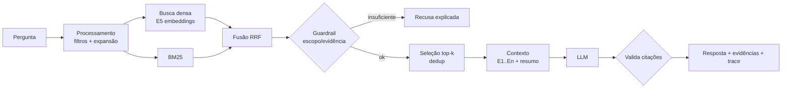

# Voice of Customer Intelligence com RAG

Tech Challenge · Fase 4 · Pós-Tech IA

Solução de **Retrieval-Augmented Generation (RAG)** que transforma cerca de 42 mil avaliações escritas de clientes do [Brazilian E-Commerce Public Dataset by Olist](https://www.kaggle.com/datasets/olistbr/brazilian-ecommerce) em uma base de conhecimento consultável em linguagem natural. As respostas são **fundamentadas e rastreáveis**: cada insight cita as avaliações que o sustentam, e o sistema **recusa** perguntas fora do escopo ou sem evidência suficiente.

> "Quais reclamações relacionadas à entrega aparecem com maior frequência?"
> → resposta organizada por padrões, com citações `[E1][E4]…` que levam à avaliação original (`review_id`, nota, data, categoria, situação da entrega).

---

## Sumário

- [Problema de negócio](#problema-de-negócio)
- [Arquitetura](#arquitetura)
- [Tecnologias](#tecnologias)
- [Como executar](#como-executar)
- [Estratégia do pipeline RAG](#estratégia-do-pipeline-rag)
- [Preparação da base](#preparação-da-base)
- [Respostas fundamentadas e perguntas sem evidência](#respostas-fundamentadas-e-perguntas-sem-evidência)
- [Metadados (desafio adicional)](#metadados-desafio-adicional)
- [Avaliação](#avaliação)
- [Exemplos de perguntas e respostas](#exemplos-de-perguntas-e-respostas)
- [Principais decisões técnicas](#principais-decisões-técnicas)
- [Estrutura do repositório](#estrutura-do-repositório)
- [Limitações e próximos passos](#limitações-e-próximos-passos)

---

## Problema de negócio

Gestores de e-commerce têm milhares de avaliações, mas a nota (1–5) não explica **por que** o cliente está satisfeito ou não. Essa informação está no texto livre, que é inviável de ler manualmente. A solução permite perguntar, por exemplo:

- Quais são os principais problemas relatados pelos clientes?
- O que os clientes mais elogiam?
- Que padrões aparecem nas avaliações de clientes insatisfeitos?
- Quais avaliações sustentam a conclusão de que há problemas recorrentes de prazo?

…e receber respostas **baseadas exclusivamente em avaliações reais**, com as evidências exibidas.

## Arquitetura



Detalhes de cada componente: [docs/arquitetura.md](docs/arquitetura.md).

## Tecnologias

| Camada | Escolha | Por quê |
|---|---|---|
| Linguagem | Python 3.10+ | ecossistema de NLP/ML |
| Dados | pandas, pyarrow (Parquet) | junções e persistência tipada |
| Embeddings | `intfloat/multilingual-e5-small` via `sentence-transformers` | multilíngue (PT-BR), leve, roda local em CPU; sem custo nem dependência de API |
| Índice vetorial | busca exata em NumPy (cosseno) + Parquet | cerca de 42 mil vetores: consulta em milissegundos, sem perda de recall e sem infraestrutura |
| Busca lexical | `rank-bm25` | reforça termos exatos e curtos ("não recebi", "quebrado") |
| Reranker (opcional) | cross-encoder `mmarco-mMiniLMv2` | maior precisão na ordenação, ao custo de latência |
| LLM | Google Gemini (`gemini-3.5-flash-lite`, via SDK `google-genai`; modelo configurável no `.env`) | segue bem as regras de citação e recusa, responde em poucos segundos e tem cota gratuita que comporta a demonstração e a avaliação; ver [`src/voc_rag/generation/llm.py`](src/voc_rag/generation/llm.py) |
| Interface | Streamlit | demonstração com filtros, evidências e trace |
| Testes | pytest | 38 testes unitários e de pipeline, sem baixar modelos nem chamar o LLM |

## Como executar

### 1. Ambiente

```bash
git clone <url-do-repositorio>
cd tech-challenge-fase-4
python -m venv .venv
# Windows: .venv\Scripts\activate   |   Linux/macOS: source .venv/bin/activate
pip install -r requirements.txt
```

O [`requirements.txt`](requirements.txt) instala tudo o que o projeto usa (dados, embeddings, BM25, SDK do Gemini, Streamlit e pytest) e também o próprio pacote `voc_rag` em modo editável. Sem essa última parte, os scripts e o app falham com `No module named 'voc_rag'`.

Os pacotes opcionais estão comentados no fim do arquivo: `kaggle`, para baixar o dataset automaticamente, e `ipykernel` e `matplotlib`, para os notebooks.

Alternativa equivalente, pelo `pyproject.toml`: `pip install -e ".[dev,llm]"`.

> A primeira instalação baixa o PyTorch (dependência do `sentence-transformers`) e pode levar alguns minutos.

### 2. Dados

Baixe o dataset do Kaggle e coloque os CSVs em `data/raw/`:

```bash
# com a Kaggle API configurada (pip install kaggle + ~/.kaggle/kaggle.json)
python scripts/download_data.py
# ou, a partir de uma pasta onde o zip já foi extraído
python scripts/download_data.py --from-dir /caminho/para/archive
```

### 3. Construir a base de conhecimento e o índice

```bash
python scripts/build_knowledge_base.py   # menos de 1 min → data/processed/documents.parquet
python scripts/build_index.py            # cerca de 9 min em CPU de 14 núcleos (só na primeira vez) → data/vectorstore/
```

### 4. Configurar o LLM

O projeto usa o Google Gemini. Para gerar a sua chave de API no Google AI Studio:

1. Acesse [aistudio.google.com](https://aistudio.google.com) e entre com a sua conta Google.
2. No menu lateral, clique em **Get API key**.
3. Clique em **Create API key** e escolha (ou crie) um projeto do Google Cloud.
4. Copie a chave gerada.

Depois, crie o seu `.env` a partir do modelo e cole a chave em `LLM_API_KEY`:

```bash
cp .env.example .env
```

> ⚠️ A chave é pessoal: guarde-a só no `.env` (que já está no `.gitignore`) e nunca a coloque no código, no README ou em commits.

**Sem o LLM configurado, todo o pipeline funciona em modo "somente recuperação"**: a interface e a CLI mostram as evidências recuperadas, o trace e o contexto que seria enviado ao modelo.

### 5. Usar

```bash
streamlit run app/streamlit_app.py
```

```bash
python scripts/ask.py "Quais são os principais problemas relatados pelos clientes?" --trace
python scripts/ask.py "O que os clientes elogiam?" --categoria cama_mesa_banho --nota-min 4
python scripts/ask.py "Problemas de entrega" --entrega atrasado --periodo 2018-01 2018-08
```

### 6. Testes e avaliação

```bash
python -m pytest -q
python evaluation/run_eval.py                                              # conjunto principal (não usa o LLM)
python evaluation/run_eval.py --questions evaluation/questions_holdout.yaml # conjunto hold-out
python evaluation/run_eval.py --with-llm                                   # inclui a geração e a taxa de citação
python scripts/generate_examples.py                                        # regenera docs/exemplos.md
```

## Estratégia do pipeline RAG

1. **Transformação da pergunta** ([query_processing.py](src/voc_rag/retrieval/query_processing.py)): regras determinísticas e explicáveis:
   - extraem **filtros de metadados** da linguagem natural ("nota baixa" → notas 1–2; "insatisfeitos" → 1–2; "elogios" → 4–5; "celulares" → `telefonia`; "2018" → período; "entrega atrasada" → `delivery_status=atrasado`);
   - **reescrevem a pergunta para o seu núcleo**, removendo o enquadramento analítico que não se parece com nenhuma avaliação ("O que os clientes relatam sobre problemas relacionados à entrega?" → `problemas entrega`). O núcleo é o texto embedado;
   - identificam **termos-chave** (o núcleo sem palavras de intenção), usados pelos guardrails;
   - detectam **temas** (entrega, qualidade, atendimento…) para expandir a consulta lexical com sinônimos.
2. **Recuperação semântica híbrida** ([retriever.py](src/voc_rag/retrieval/retriever.py)): pré-filtro exato por metadados → busca densa (E5, cosseno) **e** BM25 → **Reciprocal Rank Fusion**. A busca densa entende paráfrases ("demorou demais" ≈ "atraso"); o BM25 garante termos exatos.
3. **Seleção** ([reranker.py](src/voc_rag/retrieval/reranker.py)): reranking opcional, corte por similaridade mínima, **deduplicação** de textos idênticos com contagem de repetições, textos muito curtos ("insatisfeito", "ótimo") movidos para o fim da fila e **MMR** (*Maximal Marginal Relevance*), para que as evidências cubram padrões diferentes em vez de 15 variações de "atraso na entrega". Por padrão, 15 evidências distintas.
4. **Construção do contexto** ([context_builder.py](src/voc_rag/generation/context_builder.py)): cada avaliação vira `[E3] (nota 1/5 | 2018-03 | categoria: telefonia | entregue com atraso) "texto"`, acompanhada de um **resumo estatístico da amostra** (distribuição de notas, entrega e categorias). Isso reduz o risco de o modelo inventar frequências.
5. **Geração** ([prompts.py](src/voc_rag/generation/prompts.py)): o prompt exige usar só as evidências, citar `[En]` em cada afirmação, descrever frequência relativa à amostra e responder `SEM_EVIDENCIAS_SUFICIENTES` quando não houver base.
6. **Validação** ([guardrails.py](src/voc_rag/generation/guardrails.py)): remove citações inexistentes, sinaliza respostas sem citação e converte o marcador de recusa em status `insufficient_evidence`.

Cada execução gera um **trace** (`RetrievalTrace`) com o resultado e o tempo de cada etapa. Ele aparece na interface, em "Como a resposta foi construída".

## Preparação da base

| Etapa | Avaliações |
|---|---:|
| Total | 99.224 |
| `review_id` duplicado | −814 |
| Sem texto (título e comentário ausentes) | −56.040 |
| Texto não informativo (`.`, `10`) | −419 |
| **Base de conhecimento** | **41.951** |

1 documento = 1 avaliação, sem chunking: os textos têm mediana de 53 caracteres. Título e comentário são combinados; acentos e caixa são preservados. Somente o texto é embedado, e os metadados vão para colunas usadas como filtro. Justificativas completas: [docs/preparacao_dados.md](docs/preparacao_dados.md).

## Respostas fundamentadas e perguntas sem evidência

Na calibração, um limiar de similaridade **não funcionou**: com o E5, "Me passe uma receita de bolo" teve similaridade 0,90 com a avaliação mais próxima, maior que várias perguntas legítimas (~0,86). Por isso o [guardrail](src/voc_rag/generation/guardrails.py) combina sinais complementares e explicáveis, todos avaliados **antes de chamar o LLM**:

| Situação | Sinal | Status |
|---|---|---|
| Filtros sem resultado ("seguros e serviços em 2016") | 0 documentos no recorte | `insufficient_evidence` |
| Fora do domínio ("capital da Austrália", "taxa Selic") | o [classificador de escopo](src/voc_rag/generation/scope.py) compara a pergunta com 25 perguntas-exemplo do domínio e 25 de fora dele; a margem é negativa e não há suporte lexical | `out_of_scope` |
| Conceito inexistente na base ("pagar com criptomoedas") | termo-chave presente em menos de 3 avaliações | `insufficient_evidence` |
| Combinação sem suporte ("entrega por drone") | menos de 3 avaliações contêm 60% dos termos-chave | `insufficient_evidence` |
| Pouca evidência semântica | menos de 3 candidatos com similaridade ≥ 0,85 | `insufficient_evidence` |
| Evidências que não respondem a pergunta | o LLM devolve `SEM_EVIDENCIAS_SUFICIENTES` | `insufficient_evidence` |
| LLM cita evidência inexistente | a citação é removida e um aviso é exibido | `answered`, com aviso |

O motivo de cada decisão aparece no trace (ex.: "termo(s) praticamente ausente(s) das avaliações: criptomoedas").

## Metadados (desafio adicional)

Metadados usados: **nota**, **período da compra**, **categoria do produto**, **situação da entrega** (no prazo, atrasado, não entregue, cancelado; derivada das datas real e estimada) e **UF**.

**Por que melhoram a recuperação:** a nota e a situação da entrega **não estão no texto** do comentário. Uma busca puramente semântica por "problemas em avaliações com nota baixa" recupera textos que *parecem* negativos, mas não garante a nota. O **pré-filtro exato** restringe o espaço de busca antes da similaridade, de modo que 100% das evidências respeitam o recorte pedido e o top-k não é "gasto" com avaliações fora do recorte. Os filtros podem ser extraídos automaticamente da pergunta ou escolhidos na interface. A extração automática pode ser desligada.

## Avaliação

O script [`run_eval.py`](evaluation/run_eval.py) calcula as métricas de recuperação e de guardrail sem gastar tokens. Com `--with-llm`, também gera as respostas e mede as citações. São dois conjuntos:

- [`questions.yaml`](evaluation/questions.yaml), com 19 perguntas: os 6 exemplos do enunciado, 6 com metadados, 4 fora do escopo e 3 sem evidência suficiente. **Foi usado para calibrar** as regras e os limiares.
- [`questions_holdout.yaml`](evaluation/questions_holdout.yaml), com 22 perguntas **novas**, escritas depois da calibração para medir a generalização.

| Métrica | Conjunto principal | Hold-out |
|---|---:|---:|
| Decisão correta (responder × recusar) | 19/19 (100%) | 21/22 (95%)¹ |
| Perguntas válidas respondidas | 12/12 | 14/14 |
| Perguntas a recusar recusadas | 7/7 | 7/8 |
| Precisão@15 das evidências (proxy por tema) | 0,92 | — |
| Filtros extraídos corretamente | 6/6 | — |
| Evidências que respeitam os filtros | 100% | 100% |

¹ **Leitura honesta:** na primeira execução do hold-out o resultado foi **19/22**. Dois erros revelaram falhas genéricas, que foram corrigidas: "não" tratado como termo-chave, e perguntas sem tema sobre um recorte filtrado ("O que motiva as notas 3?"). Depois da correção o resultado passou a 21/22, mas esse número já não é totalmente independente. O erro restante, "realidade virtual no site", passa porque "loja **virtual**" e "**site**" são frequentes nas avaliações. É o tipo de caso em que a segunda barreira (o LLM declarar que as evidências não sustentam a resposta) é necessária.

A precisão@15 é uma aproximação: mede a fração das evidências cujo texto trata do tema da pergunta, por regex. Não substitui a avaliação humana da relevância.

### Com o LLM (`--with-llm`, `gemini-3.5-flash-lite`)

| Métrica | Conjunto principal | Hold-out |
|---|---:|---:|
| Decisão correta, incluindo a recusa feita pelo LLM | 19/19 (100%) | 20/22 (91%)² |
| Perguntas válidas respondidas | 12/12 | 12/14 |
| Perguntas a recusar recusadas | 7/7 | **8/8** |
| Respostas com citações válidas | 100% | 100% |
| Evidências citadas por resposta (média, de 15) | 14,2 | 13,0 |
| Falhas na chamada ao LLM | 0 | 0 |

² Com o LLM, a segunda barreira **funcionou**: o Gemini declarou `SEM_EVIDENCIAS_SUFICIENTES` para "realidade virtual no site", único caso que passava pelos guardrails pré-geração. Em troca, recusou duas perguntas válidas: "Os clientes recebem o pedido em mais de uma entrega?" e "O que os clientes falam do tamanho das peças de roupa?". Inspecionando as evidências, **as recusas estão corretas**: a recuperação trouxe avaliações genéricas sobre entrega no primeiro caso e "peças" e "tamanho" de móveis e colchões no segundo. O LLM preferiu não inventar. A falha está na recuperação, não na geração.

## Exemplos de perguntas e respostas

Ver [docs/exemplos.md](docs/exemplos.md): respostas geradas pelo Gemini para as perguntas do enunciado e para perguntas com metadados, com os filtros extraídos, as evidências usadas (citadas marcadas com ✅) e as recusas.

## Principais decisões técnicas

Resumo (detalhes e alternativas consideradas em [docs/decisoes_tecnicas.md](docs/decisoes_tecnicas.md)):

- **Embeddings locais (E5 multilíngue)**, não via API: bom desempenho em PT-BR, custo zero, reprodutível offline.
- **Busca exata em NumPy** em vez de um banco vetorial: o volume é pequeno, a busca exata não perde recall e não exige infraestrutura. A interface `search()` permite trocar por FAISS, Qdrant ou pgvector.
- **Busca híbrida (densa + BM25 com RRF)**: reviews são curtas e cheias de termos decisivos ("não", "quebrado").
- **Metadados como pré-filtro**, não concatenados ao texto embedado.
- **Reescrita da pergunta para o núcleo**: o enquadramento analítico ("quais padrões podem ser identificados…") dilui a similaridade com avaliações curtas.
- **Deduplicação e MMR na seleção** (não no índice): diversidade de padrões no contexto sem perder a frequência.
- **Guardrails com múltiplos sinais antes do LLM** (escopo por exemplos, vocabulário, suporte lexical e semântico): na calibração, um limiar de similaridade não separava as perguntas fora do escopo. O LLM é a segunda barreira.

## Estrutura do repositório

```
├── app/streamlit_app.py          # interface de demonstração
├── data/                         # raw/ processed/ vectorstore/ (não versionados)
├── docs/                         # arquitetura, decisões, preparação, exemplos
│   └── apresentacao/             # slides (.pptx) e fundo para a gravação do vídeo
├── evaluation/                   # perguntas de teste + script de métricas
├── notebooks/                    # EDA, preparação, embeddings, avaliação
├── scripts/                      # download, build_knowledge_base, build_index, ask
├── src/voc_rag/
│   ├── config.py                 # configurações (.env)
│   ├── ingestion/                # loader, cleaning, documents
│   ├── indexing/                 # embeddings, vectorstore
│   ├── retrieval/                # query_processing, filters, retriever, reranker
│   ├── generation/               # prompts, context_builder, llm (Gemini), guardrails
│   ├── pipeline.py               # orquestração
│   └── schemas.py                # RAGResponse, Evidence, RetrievalTrace
├── tests/                        # pytest
├── requirements.txt              # dependências (pip install -r requirements.txt)
└── pyproject.toml                # metadados do pacote e as mesmas dependências
```

## Limitações e próximos passos

- **RAG não é contagem**: o modelo vê o top-k, não a população. Frequências são relativas à amostra recuperada. Um próximo passo é combinar o RAG com **agregações estruturadas**, como a classificação de todas as avaliações por tema seguida de contagem, para perguntas do tipo "qual o problema mais frequente".
- **Viés de quem comenta**: clientes insatisfeitos escrevem mais (77% das notas 1 têm texto, contra 36% das notas 5).
- A extração de filtros por regras é transparente, mas limitada. Uma alternativa seria a extração estruturada com o próprio LLM.
- Os limiares e as listas de palavras dos guardrails foram calibrados para este domínio e para o E5. Ao trocar o modelo de embedding, recalibre (ver o notebook 03 e o conjunto hold-out).
- O suporte lexical pode ser enganado por termos frequentes em outro sentido ("realidade **virtual**" × "loja **virtual**").
- A avaliação das respostas geradas mede citações e recusas, mas não verifica se cada afirmação é de fato sustentada pela avaliação citada. O próximo passo é medir essa fidelidade (*faithfulness*) com um LLM juiz.
- Perguntas sobre aspectos muito específicos ("tamanho das peças de roupa", "pedido em mais de uma entrega") podem não recuperar as avaliações certas. O LLM recusa corretamente, mas a resposta existia na base. Um reranker ou a expansão da consulta por LLM podem ajudar.
- A cota gratuita do Gemini é diária e por modelo (20 respostas por dia no `gemini-3.5-flash`). Para uso contínuo, é preciso ativar o faturamento no projeto da chave.
