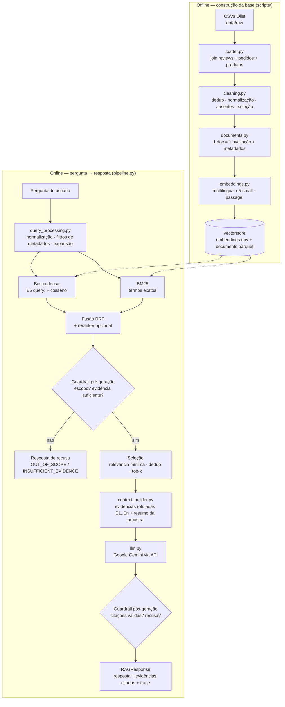

# Arquitetura

## Visão geral

## Componentes

| Etapa do enunciado | Módulo | O que faz |
|---|---|---|
| Processamento da pergunta | [`retrieval/query_processing.py`](../src/voc_rag/retrieval/query_processing.py) | Normaliza; extrai filtros (nota, sentimento, categoria, período, entrega atrasada); reescreve para o núcleo da pergunta; identifica termos-chave; detecta temas e expande a consulta lexical |
| Representação vetorial | [`indexing/embeddings.py`](../src/voc_rag/indexing/embeddings.py) | `multilingual-e5-small` com prefixos `query:` e `passage:`; vetores normalizados |
| Recuperação | [`retrieval/retriever.py`](../src/voc_rag/retrieval/retriever.py) + [`indexing/vectorstore.py`](../src/voc_rag/indexing/vectorstore.py) | Pré-filtro por metadados → busca densa exata + BM25 → fusão RRF |
| Seleção | [`retrieval/reranker.py`](../src/voc_rag/retrieval/reranker.py) | Reranking opcional (cross-encoder), corte por relevância mínima, deduplicação, textos curtos no fim da fila, diversidade por MMR, top-k |
| Construção do contexto | [`generation/context_builder.py`](../src/voc_rag/generation/context_builder.py) | Evidências `[E1]..[En]` com nota/período/categoria/entrega + resumo estatístico da amostra |
| Geração | [`generation/llm.py`](../src/voc_rag/generation/llm.py) + [`prompts.py`](../src/voc_rag/generation/prompts.py) | Prompt com regras de grounding e citação; chamada ao Google Gemini (`gemini-3.5-flash-lite`) com tentativas automáticas e fallback para somente recuperação |
| Evidências insuficientes | [`generation/guardrails.py`](../src/voc_rag/generation/guardrails.py) + [`scope.py`](../src/voc_rag/generation/scope.py) | Pré-geração (classificador de escopo, vocabulário, suporte lexical e semântico) e pós-geração (marcador de recusa, citações inválidas) |
| Orquestração e rastreabilidade | [`pipeline.py`](../src/voc_rag/pipeline.py) + [`schemas.py`](../src/voc_rag/schemas.py) | Executa as etapas e registra um `RetrievalTrace` com o resultado e o tempo de cada uma |

## Interfaces

- **Streamlit** ([`app/streamlit_app.py`](../app/streamlit_app.py)): pergunta livre ou de exemplo, filtros na barra lateral, resposta com status, tabela de evidências (citadas marcadas), gráficos da amostra e trace completo, incluindo o contexto enviado ao LLM.
- **CLI** ([`scripts/ask.py`](../scripts/ask.py)): mesma funcionalidade no terminal, com `--trace` e `--json`.
- **Avaliação** ([`evaluation/run_eval.py`](../evaluation/run_eval.py)): roda o conjunto de perguntas e calcula as métricas.

## Status de resposta

| Status | Quando |
|---|---|
| `answered` | Evidências suficientes e o LLM gerou uma resposta com citações |
| `out_of_scope` | O classificador de escopo aproxima a pergunta de exemplos fora do domínio e não há suporte lexical na base |
| `insufficient_evidence` | Os filtros não retornam nada, há poucas avaliações relevantes, ou o próprio LLM declarou que as evidências não sustentam uma resposta |
| `retrieval_only` | O LLM não está configurado ou a chamada falhou (ex.: modelo sobrecarregado): o sistema devolve as evidências recuperadas, sem texto gerado, e explica o motivo |
